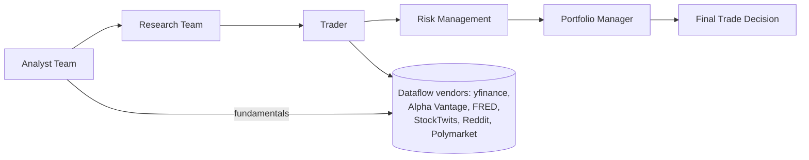

# Project Overview

TradingAgents is an open-source, multi-agent LLM financial trading and research
framework. It mirrors the structure of a real trading firm by composing
specialized LLM-powered agents — fundamentals, sentiment, news, and technical
analysts; bull/bear researchers who debate; a trader; a three-tier risk
management team; and a portfolio manager — into a single LangGraph workflow that
collaboratively evaluates a ticker on a given date and produces a final trade
decision. Market, social, and news data are pulled from real vendors
(yfinance, Alpha Vantage, FRED, StockTwits, Reddit, Polymarket) through a
verified data-access contract, and every decision is persisted to a memory log
that feeds forward into later analyses. The project ships a rich interactive
CLI (`tradingagents analyze`), a durable Reflex web console for background runs,
evaluation, memory, and portfolio management, and a backtesting harness — all
installable as the `tradingagents` Python package (PyPI). It is research
software, not investment advice, and trading performance varies with model,
temperature, and data quality.

# Repository Structure

- `tradingagents/` — the core framework package (the library you import).
- `cli/` — the reflex/typer `tradingagents` command-line entry point and its UI logic.
- `tests/` — pytest suite (unit + integration + smoke), organized per feature area.
- `assets/` — README images, favicon, bundled styles and CLI static assets.
- `docs/` — deeper design docs (currently the web-UI specification).
- `scripts/` — small helper scripts (e.g. smoke tests for the graph).
- `.github/` — CI workflow definitions.
- `main.py` — minimal programmatic example running `TradingAgentsGraph.propagate()`.
- `test.py` — a throwaway timing check for a dataflows function (dev scratch, not part of the suite).
- `pyproject.toml` — packaging, dependencies, ruff and pytest configuration.
- `rxconfig.py` — Reflex app configuration for the web console.
- `Dockerfile` + `docker-compose.yml` — containerized web/worker/CLI/ollama stack.
- `CHANGELOG.md` — release history. `LICENSE` — Apache 2.0.

# Build & Development Commands

Install the package (editable, with dev extras) using `uv` and run the tools:

```bash
# Create and activate a uv-managed environment (python 3.12)
uv venv --python 3.12
source .venv/bin/activate

# Install editable with dev, web, and bedrock extras
uv pip install -e ".[dev,web,bedrock]"
```

If you are not already inside a uv-managed environment, activate the one `uv`
created before running the commands below, or prefix each with
`uv run` (e.g. `uv run ruff check .`, `uv run pytest -q`).

Lint (strict, full repo — must pass before merge):

```bash
ruff check .
# Also run the formatter check if you adopt formatting changes
ruff format --check .
```

Run the test suite:

```bash
pytest -q                       # default: all tests
pytest -m unit                  # fast isolated unit tests
pytest -m integration           # tests requiring external services
pytest -m smoke                 # quick sanity-checks
pytest tests/test_symbol_utils.py   # single file
```

Type-checking: there is no dedicated type-check command configured; the code
uses inline runtime annotations. `pyproject.toml` sets `target-version = "py310"`.
> TODO: none of the configured tooling runs a full static type checker today.

Run the interactive CLI analysis:

```bash
tradingagents analyze
tradingagents analyze --checkpoint          # enable checkpoint-resume
tradingagents analyze --no-checkpoint       # disable it for this run
tradingagents analyze --clear-checkpoints   # reset saved state before running
tradingagents analyze --portfolio my_book.json
```

Run the web console (Reflex):

```bash
reflex run --env prod --single-port         # app served on frontend_port (8501)
```

Programmatic run (see `main.py`):

```bash
python main.py
```

Docker (installs `".[web,bedrock]"`, precompiles, serves the web console):

```bash
docker compose up --build -d web worker     # web + background worker
docker compose --profile cli run --rm tradingagents        # interactive CLI
docker compose --profile ollama up --build -d ollama web worker  # local Ollama
```

Debugging: the graph supports streaming and debug mode; checkpoints give
step-level resume. Run `pytest -m unit -x` to isolate a failing test quickly.

Deploy: no first-party deploy pipeline; the Compose stack and Dockerfile are the
reference path. See `docs/web-ui-specification.md` for architecture of the web
console.

# Code Style & Conventions

- Line length: 100 chars (`[tool.ruff] line-length = 100`). E501 is ignored for
  lint because layout is owned by the formatter.
- Ruff rule set: `E, W, F, I, B, UP, C4, SIM` (pyflakes + pycodestyle + isort +
  bugbear + pyupgrade + comprehensions/simplify). Keep it passing: `ruff check .`.
- `**/__init__.py` intentionally re-exports, so `F401` is ignored there.
- isort uses `combine-as-imports = true`: merge multiple aliased imports from one
  module into a single combined block (see the vendor re-exports in
  `tradingagents/dataflows/interface.py`).
- Target Python: 3.10 (`py310`); CI runs 3.10–3.13. Use `from __future__ import
  annotations` where forward references are needed.
- Docstrings: standard module-level docstring; API comments are measured and
  carve out rationale (see `default_config.py`, `cli/main.py`).
- Whole-repo `ruff format` adoption is deferred until the open-PR backlog clears
  (to avoid mass merge conflicts) — do not reformat unrelated lines.
- Naming: snake_case for modules/functions/vars; classes PascalCase. Config keys
  exposed via env use the `TRADINGAGENTS_*` prefix.
- Commit style follows the Conventional Commits convention seen in history:
  `feat:`, `fix:`, `docs:`, `chore:`, `test:`, `refactor:`, with a scoped subject
  where useful. Templates: `fix(dataflows): <short subject>` or
  `test: <subject>`.
- `RESULTS_DIR` / generated `results/` output is excluded from lint via ruff
  `extend-exclude`.

Commit message template:

```
<type>(<scope>): <imperative summary>

<optional body explaining the why>
```

# Architecture Notes

TradingAgents orchestrates a single LangGraph workflow. Entry via
`TradingAgentsGraph` (in `tradingagents/graph/trading_graph.py`) builds two LLM
clients (deep-think and quick-think) from the configured provider, wires tool
nodes, and compiles a `GraphSetup` workflow that is streamed by a `Propagator`.



Pipeline stages (mirroring a trading firm):

1. **Analyst Team** — Market, Sentiment/News, Fundamentals, and Technical
   analysts each produce a report (the set is user-selectable). They consume
   vendor data through the `tradingagents/dataflows` layer.
2. **Research Team** — Bull and Bear researchers debate the analysts' input;
   the Research Manager judges and emits an investment plan.
3. **Trader** — Composes the analyst + research reports into a trade plan.
4. **Risk Management** — Aggressive, Neutral, and Conservative analysts review
   the plan; a risk debate converges on a recommendation.
5. **Portfolio Manager** — Approves/rejects the final trade decision.

Major components and their folders:

- `agents/analysts`, `agents/researchers`, `agents/managers`,
  `agents/risk_mgmt`, `agents/trader` — the LangChain agent definitions.
- `agents/utils/` — shared tools (`core_stock_tools`, `fundamental_data_tools`,
  `macro_data_tools`, `news_data_tools`, `market_data_validation_tools`,
  `prediction_markets_tools`, `technical_indicators_tools`), memory
  (`memory.py`), rating (`rating.py`), and structured-output helpers.
- `dataflows/` — a verified data-access contract across vendors; a single
  `interface.py` re-exports the dataflow functions. Includes look-ahead /
  point-in-time guards so past dates never see future data.
- `graph/` — workflow setup, propagation, reflection, conditional/analyst-exec
  logic, checkpointing, and signal processing.
- `llm_clients/` — provider abstraction (OpenAI, Anthropic, Google, Azure,
  Bedrock, Ollama, OpenRouter, Mistral, Groq, NVIDIA, Qwen, GLM, MiniMax,
  DeepSeek, and any OpenAI-compatible endpoint) plus a provider/model catalog.
- `default_config.py` — `DEFAULT_CONFIG`; the single source of truth for
  `TRADINGAGENTS_*` env-var overrides (typed coercion).
- `persistence/` — SQLite database, run repository, and a secret store.
- `runtime/` — durable background run queue/worker for the web console.
- `web/` — the Reflex app (dashboard, new-analysis, runs, portfolio, memory,
  evaluation, settings pages).
- `portfolio.py` / `backtest.py` / `reporting.py` — portfolio context,
  decision-grid backtest, and report-tree writer shared by CLI and API.

Data flow: the CLI/`main.py` builds an initial state via `create_run_state`,
streams the compiled graph node-by-node, and renders live agent progress while
writing reports under `results/`. Decisions are appended to the memory log at
`~/.tradingagents/memory/trading_memory.md`; on subsequent runs the framework
fetches realised returns, writes a reflection, and re-injects relevant lessons
into the Portfolio Manager prompt.

# Testing Strategy

- **Framework**: pytest (markers `unit`, `integration`, `smoke`; strict
  markers; `testpaths = ["tests"]`).
- **Style**: tests are flat files in `tests/` grouped by feature (e.g.
  `test_symbol_utils.py`, `test_llm_max_retries.py`, `test_checkpoint_resume.py`,
  `test_fred.py`, `test_polymarket.py`). `conftest.py` provides shared fixtures.
- Key coverage areas: look-ahead/point-in-time hardening (Alpha Vantage, FRED,
  news, social), provider configs (retry/token/thinking knobs), vendor
  routing/resilience, symbol normalization, checkpoint lifecycle, memory
  point-in-time, and the web-UI portfolio.
- **Run locally**: `pytest -q`. Prefer `pytest -m unit` for fast feedback.
- **In CI**: `.github/workflows/ci.yml` runs (a) `pytest -q` across a Python
  3.10/3.11/3.12/3.13 matrix, (b) a clean-install smoke job that does
  `pip install .` then imports `tradingagents` and `cli.main` (catches undeclared
  runtime deps), and (c) `ruff check .` (whole repo, strict). CI triggers on
  push to `main` and all PRs, with `cancel-in-progress` concurrency.
- Integration tests that hit external services are expected to be network-gated
  or skipped in local runs; keep the default `pytest -q` green in CI.

# Security & Compliance

- **Secrets**: API keys and provider credentials live in `.env` (gitignored);
  a templated `.env.example` and `.env.enterprise.example` document the schema.
  `.env` is loaded at package import via python-dotenv (`override=False`, so it
  never clobbers exported values). `tradingagents/persistence/secret_store.py`
  persists secrets for the web console. Never commit `.env` or real keys.
- **Env-var hardening**: `TRADINGAGENTS_*` values are type-coerced and fail
  loudly on invalid booleans/ints rather than silently misconfiguring a run.
- **Dependency scanning**: no dependency/vulnerability scanner is wired into
  CI today. > TODO: consider adding `pip-audit`/`osv-scanner` and a nightly job.
- **Guardrails**: vendor data flows through a verified contract; look-ahead
  guards prevent past analyses from leaking future data. Ticker symbols are
  normalized and path-traversal hardened (`safe_ticker_component`). The
  framework does not connect to brokers or place real orders.
- **License**: Apache 2.0 (see `LICENSE`). CI installs dependencies via pip
  from PyPI/GitHub; check license compatibility when adding runtime deps.
- Container runs as non-root `appuser` (uid 10001) in the Dockerfile.

# Agent Guardrails

- Never modify or commit files that are gitignored, especially `.env`,
  `.env.enterprise`, `*.db` (checkpoint/memory SQLite), `./.venv*/`, `*.egg-info/`,
  `.web/`, or generated `results/` / `reports/`.
- Do not read or transmit real API keys/credentials; treat `.env*` locals as
  secret. Prefer referencing the templated `.env.example` in documentation.
- Do not delete or rewrite persistent state under `~/.tradingagents/`
  (memory log, checkpoints, web DB) unless explicitly asked; the
  `--clear-checkpoints` flag is the sanctioned way to reset checkpoints.
- Keep `ruff check .` and `pytest -q` green; do not reformat unrelated lines to
  avoid merge conflicts (formatting adoption is deferred).
- Do not touch `CHANGELOG.md` release entries or the vendored `tradingagents.egg-info/`.
- External API calls (LLM providers, market data vendors) must respect existing
  retry/caching guards; do not add unbounded loops or bursty requests.
- Preserve the data-access contract and point-in-time correctness in `dataflows/`;
  a change that would let an analysis see future data is a regression.

# Extensibility Hooks

- **Config override via env**: any key in `_ENV_OVERRIDES`
  (`tradingagents/default_config.py`) can be set as a `TRADINGAGENTS_*` variable
  (provider, deep/quick think models, backend URL, output language, debate/risk
  round counts, checkpoint toggle, temperature, retry budget, max tokens, and
  provider reasoning/thinking levels). Add a new row there to expose a new key.
- **Provider registry**: `llm_clients/provider_catalog.py` + `model_catalog.py`
  define available providers/models. A new provider implements `base_client.py`
  and is registered in the factory (`llm_clients/factory.py`).
- **Dataflow vendors**: `dataflows/interface.py` re-exports the vendor dataflow
  functions; add a vendor module under `dataflows/` and re-export it to extend
  market/social/macro data sources.
- **Feature flags / knobs**: `default_config.py` keys and the `TRADINGAGENTS_*`
  override table; checkbox-style runtime knobs surfaced in the CLI/web UI.
- **Plugin points**: the LangGraph workflow (`graph/setup.py`) is the graph
  assembly point; adding an analyst node touches `GraphSetup`, the analyst
  execution plan, and the CLI report/status mapping.

# Further Reading

- `README.md` — installation, CLI, package usage, portfolio, persistence, and
  reproducibility notes.
- `CHANGELOG.md` — versioned release history and behavioral changes.
- `docs/web-ui-specification.md` — the durable Reflex web-console architecture
  and page/run/worker design.
- `tradingagents/default_config.py` — the canonical config schema and
  `TRADINGAGENTS_*` override table.
- `tradingagents/graph/trading_graph.py` — the orchestrator's public API
  (init, `propagate`, `create_run_state`, checkpoint entry points).
- `tests/` — behavior contracts; read alongside each subsystem.
- Research background: arXiv `2412.20138` (TradingAgents) and the Trading-R1
  technical report (referenced from the README).