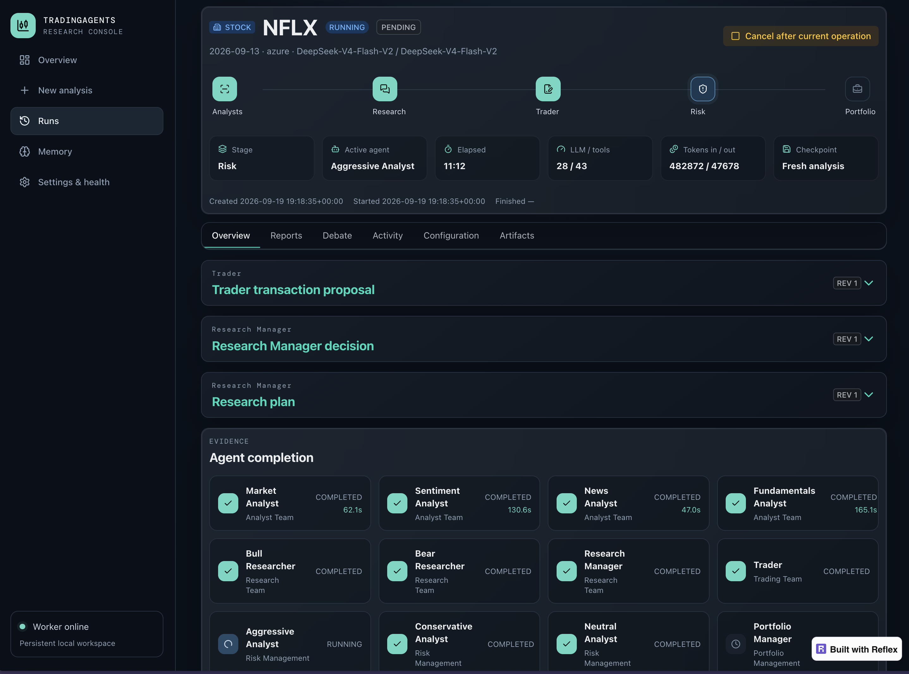
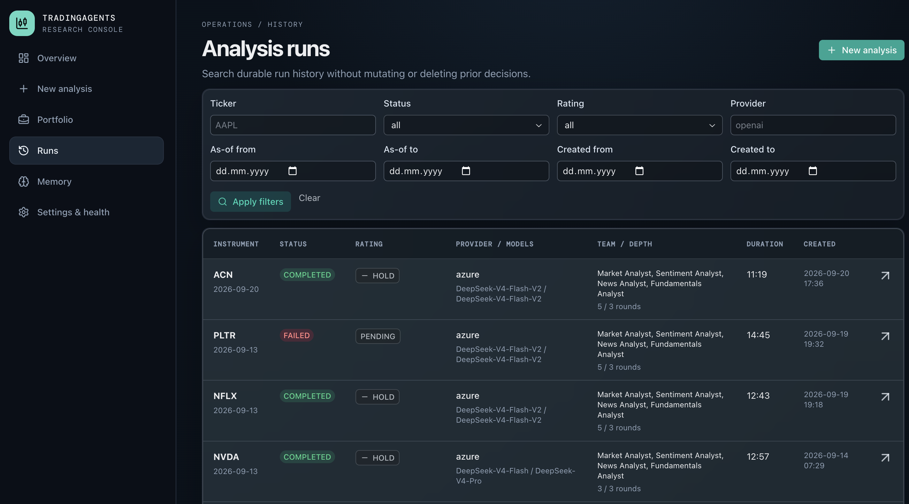

<p align="center">
  
</p>

TradingAgents is a multi-agent LLM financial research framework that mirrors how a
real trading firm works. It composes specialised agents - market, sentiment, news, and
fundamentals analysts, bull/bear researchers who debate, a trader, a three-tier risk
team, and a portfolio manager - into a single LangGraph workflow that evaluates a
ticker on a given date and produces a final trade decision. Market, social, and macro
data come from real vendors (Yahoo Finance, Alpha Vantage, FRED, StockTwits, Reddit,
Polymarket) through a verified data-access contract, and every decision is persisted to
a memory log that feeds forward into later analyses.

This fork is research and decision software, not investment advice. Trading performance
varies with the chosen model, temperature, and data quality, and the framework does not
place orders with a broker.

This repository ships both of the interfaces below: an interactive Typer CLI and a
durable Reflex web console for running analyses, reviewing reports, and managing memory
and portfolio context in a browser.

<p align="center">
  
</p>

<p align="center">
  
</p>

## Quickstart

You run the agent, the web console, and the background worker together. The worker is
what makes runs survive a closed browser tab - the UI is just a view over the durable
job store.

> Need a provider key first. Pick an LLM provider, export its key, then install.

```bash
# clone and install with the web extra
git clone <your-fork-url> trading-agents
cd trading-agents

python3 -m venv .venv
source .venv/bin/activate
pip install -e ".[web,bedrock]"   # bedrock optional; web extra pulls in Reflex

# set the provider you will use
export OPENAI_API_KEY=sk-...      # or GOOGLE_API_KEY, ANTHROPIC_API_KEY, ...
cp .env.example .env              # optional, if you prefer a dotenv file
```

### Web console + worker (Docker, recommended)

```bash
cp .env.example .env              # put your provider key here
docker compose up --build -d web worker
```

Open `http://localhost:8501`. The worker is a separate single-concurrency process: it
claims jobs from SQLite, executes each in an isolated child process, and keeps a
heartbeat. Runs continue after the browser closes and survive container recreation.
When the console asks for a key, add it to `.env` and restart the stack; you can also
enter it once on the Settings page, where it is stored write-only in a mode-`0600` file
inside the shared volume.

### Web console + worker (bare metal)

You need two processes. Reflex compiles the frontend and serves the backend on a single
port; the worker consumes the queue.

```bash
# terminal 1: the web console
reflex run --env prod --single-port   # serves on http://localhost:8501

# terminal 2: the durable worker
python -m tradingagents.runtime.worker
```

### Interactive CLI

The CLI runs the same graph directly from a terminal:

```bash
tradingagents analyze                    # interactive questionnaire
tradingagents analyze --checkpoint       # enable checkpoint-resume
tradingagents analyze --portfolio book.json
```

## Setup details

### LLM providers

Set the key for your chosen provider in the environment or in `.env`:

```bash
export OPENAI_API_KEY=...          # OpenAI (GPT)
export GOOGLE_API_KEY=...          # Google (Gemini)
export ANTHROPIC_API_KEY=...       # Anthropic (Claude)
export XAI_API_KEY=...             # xAI (Grok)
export DEEPSEEK_API_KEY=...        # DeepSeek
export DASHSCOPE_API_KEY=...       # Qwen - International
export ZHIPU_API_KEY=...           # GLM via Z.AI (international)
export MINIMAX_API_KEY=...         # MiniMax - Global
export OPENROUTER_API_KEY=...      # OpenRouter
export ALPHA_VANTAGE_API_KEY=...   # Alpha Vantage
```

For Azure, AWS Bedrock, Ollama, or any OpenAI-compatible endpoint (vLLM, LM Studio,
llama.cpp), see the notes in `docs/reflex-app.md` and `.env.example`. The web console
lets you pick provider, region, endpoint, and quick/deep models directly in the New
analysis form.

### Markets and tickers

TradingAgents works with any market Yahoo Finance covers, using the exchange-suffixed
ticker. Company identity and the alpha benchmark resolve automatically per market.

- US: `AAPL`, `SPY`
- Hong Kong: `0700.HK` · Tokyo: `7203.T` · London: `AZN.L`
- India: `RELIANCE.NS`, `.BO` · Canada: `.TO` · Australia: `.AX`
- China A-shares: `.SS` (Shanghai), `.SZ` (Shenzhen)
- Crypto: `BTC-USD`, `ETH-USD`

## Using the framework as a library

Import the graph and call `propagate()`:

```python
from tradingagents.graph.trading_graph import TradingAgentsGraph
from tradingagents.default_config import DEFAULT_CONFIG

ta = TradingAgentsGraph(config=DEFAULT_CONFIG.copy())
_, decision = ta.propagate("NVDA", "2026-01-15")
print(decision)
```

Tune the config (providers, models, debate rounds) and pass a portfolio for
portfolio-aware decisions:

```python
from tradingagents.portfolio import PortfolioContext

config = DEFAULT_CONFIG.copy()
config["llm_provider"] = "openai"
config["deep_think_llm"] = "gpt-5.6"
config["quick_think_llm"] = "gpt-5.6-luna"
config["max_debate_rounds"] = 2

portfolio = PortfolioContext.model_validate({
    "cash": 25000.0,
    "currency": "USD",
    "positions": [{"ticker": "NVDA", "quantity": 120, "average_price": 150.0}],
})

ta = TradingAgentsGraph(config=config)
_, decision = ta.propagate("NVDA", "2026-01-15", portfolio=portfolio)
```

An empty `positions` list means an explicitly flat book, which differs from passing no
portfolio. Portfolio context is manual research input only: it does not connect to a
broker, place orders, calculate P&L, or manage tax lots.

See `tradingagents/default_config.py` for the full config schema and the
`TRADINGAGENTS_*` env-var override table.

## Persistence and recovery

Two kinds of state persist across runs, under `~/.tradingagents/`.

**Decision log** (always on). Each completed run appends its decision to
`memory/trading_memory.md`. On the next run for the same ticker, the framework fetches
the realised return (raw and alpha vs the benchmark), writes a one-paragraph
reflection, and injects the most recent same-ticker decisions plus recent cross-ticker
lessons into the Portfolio Manager prompt. Override the path with
`TRADINGAGENTS_MEMORY_LOG_PATH`. In the console, the Memory page has **Refresh eligible
outcomes**, which settles every pending ticker explicitly once its five-session window
is complete, and the Evaluation page runs an isolated decision-quality grid without
touching live lessons.

**Checkpoints** (opt-in via `--checkpoint` or `checkpoint_enabled`). LangGraph saves
state after each node so a crashed or interrupted run resumes from the last successful
step. Per-ticker SQLite databases live at `cache/checkpoints/<TICKER>.db`; use
`--clear-checkpoints` to reset all of them. A checkpoint is compatible only when ticker,
date, analysts, debate rounds, and asset type match.

## Reproducibility

Two runs of the same ticker and date can differ. That is expected for an
LLM-driven tool, not a defect. The variation comes from model sampling (reasoning
models vary the most) and live data (news, StockTwits, and Reddit reflect "now" even
for a past trade date). To tighten it, lower `temperature` and prefer a non-reasoning
model via the Custom model ID option - the current curated models are reasoning-first
and largely ignore temperature.

What does not vary: company identity is resolved deterministically from the ticker
before any agent runs, and the market analyst grounds price and indicator claims in a
verified data snapshot. Backtest results are not guaranteed to match any published
figure.

## Development

```bash
pip install -e ".[dev,web,bedrock]"

ruff check .                 # strict, whole repo
pytest -q                    # full suite
pytest -m unit               # fast isolated tests
pytest -m smoke              # quick sanity checks
```

Tests are grouped by feature in `tests/`. Integration tests are network-gated and skip
in local runs. There is no dedicated type-check command yet; the code uses inline
runtime annotations.

Repository layout: `tradingagents/` is the importable framework, `cli/` is the Typer
entry point, `docs/` holds architecture notes (`docs/reflex-app.md` documents the web
console, `docs/web-ui-specification.md` is the original product/engineering spec),
`tests/` is the pytest suite. `CHANGELOG.md` tracks behaviour changes by release.

## Contributing

Bug fixes, documentation, and feature ideas are welcome. Keep `ruff check .` and
`pytest -q` green, and do not reformat unrelated lines. Do not touch `.env*`, `*.db`,
generated `results/`, or anything under `~/.tradingagents/` unless asked.

## Citation

Please reference the original work if TradingAgents is useful to you:

```
@misc{xiao2025tradingagentsmultiagentsllmfinancial,
      title={TradingAgents: Multi-Agents LLM Financial Trading Framework},
      author={Yijia Xiao and Edward Sun and Di Luo and Wei Wang},
      year={2025},
      eprint={2412.20138},
      archivePrefix={arXiv},
      primaryClass={q-fin.TR},
      url={https://arxiv.org/abs/2412.20138},
}
```